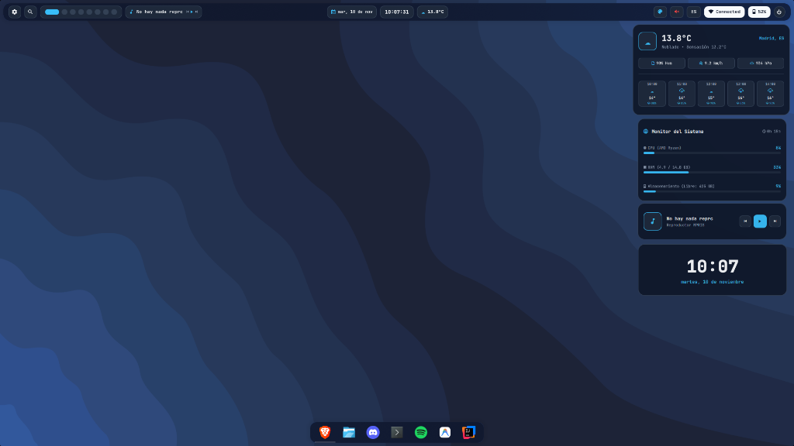

<div align="center">

# 🐍 Serpanplasma — Serpantinum for KDE Plasma 6

**La alternativa flotante y recreación estética de alta fidelidad de *Serpantinum* adaptada de forma nativa para KDE Plasma 6 (Wayland).**

[🇪🇸 Español](README.md) | [🇬🇧 English](README_EN.md)

[](https://github.com/ilyamiro/serpantinum)
[](https://kde.org/plasma-desktop/)
[](https://wayland.freedesktop.org/)
[](#-instalación-por-distribución)
[](#-características-principales)
[](LICENSE)

<br/>



</div>

---

## 📖 Visión General

**Serpanplasma** es una recreación fiel y precisa de la estética minimalista de **[Serpantinum](https://github.com/ilyamiro/serpantinum)** (el entorno de escritorio creado por ilyamiro basado en Quickshell), implementada nativamente para **KDE Plasma 6 sobre Wayland**.

El proyecto traslada el diseño visual moderno de Serpantinum —con su icónica barra de píldoras translúcidas, esquinas redondeadas y desenfoque (*blur*) en tiempo real— a KDE Plasma, eliminando la curva de aprendizaje de los gestores de ventanas en mosaico (*tiling managers* como Hyprland o Niri) y conservando la comodidad, productividad y estabilidad de la gestión de ventanas flotantes clásica.

---

## 🎯 Características Principales

- ❌ **Sin Tiling Forzado:** Trabaja con total libertad sin particiones automáticas de pantalla ni la necesidad de memorizar complejas combinaciones de teclas.
- 🪟 **Ventanas Flotantes Libres (Estilo Clásico / Windows):**
  - Apertura de aplicaciones centrada con dimensiones proporcionadas.
  - Arrastre, redimensionado y superposición natural mediante ratón o atajos.
  - Botones clásicos integrados en la barra de título: Minimizar (**_**), Maximizar (**□**) y Cerrar (**X**).
- ⌨️ **Atajos de Teclado Estándar:**
  - `Alt + F4`: Cerrar la ventana activa.
  - `Alt + Tab`: Conmutar entre aplicaciones en ejecución.
  - `Win + Flecha Arriba`: Maximizar la ventana activa.
  - `Win + Flecha Abajo`: Restaurar o minimizar la ventana activa.
  - `Win + E`: Abrir el gestor de archivos Dolphin.
- 🛸 **Barra Superior Flotante con Píldoras Nativas (`org.serpanplasma.bar`):**
  - Panel superior desacoplado de los bordes con esquinas redondeadas y desenfoque nativo KWin.
  - Píldoras individuales idénticas al concepto visual de Serpantinum.
- ⚓ **Dock de Aplicaciones Inferior Flotante:**
  - Panel centrado en la parte inferior de la pantalla con efecto de escala al pasar el cursor (*zoom hover*).
  - Indicadores discretos de estado de ejecución y soporte para anclar lanzadores mediante arrastrar y soltar.
- 🎛️ **Menús Desplegables Nativos (Wayland Dialogs):**
  - 󰖙 **Pronóstico Meteorológico:** Tarjeta emergente con pronóstico a 4 días, selector interactivo de jornada, sensación térmica, humedad relativa y velocidad de viento.
  - 󰃮 **Calendario Mensual:** Vista de mes completo con navegación suave de meses y reloj digital en vivo.
  - 󰁹 **Batería y Perfiles de Energía:** Monitor en tiempo real del estado de carga y conmutación entre perfiles (`Alto Rendimiento`, `Equilibrado`, `Ahorro de Batería`), con ajuste automático y dinámico de tasa de refresco y brillo según alimentación por CA o batería.
  - 󰤨 **Red y Tráfico:** Detección de interfaz activa, SSID Wi-Fi, IP Local, IP Pública y gráficas de velocidad de subida/bajada en tiempo real.
  - 󰕾 **Control de Audio:** Deslizador de volumen maestro, selector dinámico de salidas de sonido (auriculares, altavoces integrados, pantallas digitales HDMI/DisplayPort), silenciamiento rápido y niveles predefinidos.
  - 󰌌 **Distribución de Teclado:** Píldora interactiva para alternar instantáneamente entre disposiciones de teclado (por ejemplo, `ES` y `US`).
  - ⏻ **Menú de Sistema:** Diálogo emergente con acciones directas para Apagar, Reiniciar, Cerrar Sesión, Bloquear Pantalla y Suspender.
  - 󰏘 **Selector Rápido de Tema:** Conmutación en tiempo real entre 8 paletas de color.
- 🎨 **8 Esquemas de Color (Modos Oscuros y Claros):**
  - **Oscuros:** `Obsidian` (Oficial Serpantinum), `Catppuccin Mocha`, `Cyber Emerald`, `Deep Amethyst`, `Neon Ruby`.
  - **Claros:** `Porcelain White`, `Catppuccin Latte`, `Nord Snow Polar`.
- 🖼️ **Control Integral de Fondos de Pantalla:**
  - Alternador de rotación automática (presentación / *slideshow*).
  - Botón de congelado para fijar el fondo actual como estático con un solo clic.
- 🧩 **Widgets de Escritorio Modulares y Arrastrables:**
  - 4 tarjetas flotantes independientes: Monitor de Hardware (CPU, RAM, Swap, Disco y Sensores térmicos), Reloj Digital Gigante, Clima y Reproductor Multimedia MPRIS.
  - Totalmente reposicionables en cualquier zona de la pantalla con activación independiente.
- ⚙️ **Panel de Configuración y Guía Integrado (`serpanplasma-settings`):**
  - Interfaz dedicada Qt6/QML con 9 secciones temáticas para personalizar barras, docks, temas, atajos y widgets en tiempo real.
- 🖥️ **Compatibilidad Universal de Hardware:**
  - Adaptabilidad total a cualquier resolución y tasa de refresco (60Hz, 120Hz, 144Hz, 165Hz, 240Hz+).
  - Compatible con cualquier GPU (gráficos integrados Intel/AMD, tarjetas dedicadas NVIDIA/AMD o configuraciones híbridas de portátiles con gestión automática de reposo RTD3).

---

## 💎 Anatomía del Diseño (Réplica 1:1 de Serpantinum)

```
┌────────────────────────────────────────────────────────────────────────────────────────────────────────┐
│ [⚙] [ ━ ] ● ● ● ● ● ● ● [ ♫ Title ⏮ ▶ ⏭ ]   [15 oct.] [ 17:32:27 ] [󰖙 22°C]   [󰏘] [󰕾] [ES] [󰤨 Red] [󰁹 100%] [⏻] │
└────────────────────────────────────────────────────────────────────────────────────────────────────────┘
```

### 1. Barra Superior Flotante
- **Zona Izquierda:**
  - `[ ⚙ ]`: Acceso directo al panel de Configuración y Guía de Serpanplasma.
  - `[ ━ ] ● ● ● ● ● ● ●`: Píldora interactiva de 8 escritorios virtuales de KWin.
  - `[ ♫ Título - Artista ⏮ ▶ ⏭ ]`: Cápsula multimedia con metadatos MPRIS y controles de reproducción.
- **Zona Central (Trío Simétrico Centrado):**
  - `[ 15 oct. ]`: Píldora de fecha con acceso al calendario interactivo.
  - `[ 17:32:27 ]`: **Reloj digital matemáticamente centrado** con tipografía JetBrains Mono Black.
  - `[ 󰖙 22.1°C ]`: Píldora meteorológica con pronóstico detallado.
- **Zona Derecha:**
  - `[ 󰏘 ]`: Selector rápido de tema para alternar entre las 8 paletas disponibles.
  - `[ 󰕾 ]`: Control de volumen maestro con selector de salida de audio.
  - `[ ES / US ]`: Indicador y conmutador de distribución de teclado.
  - `[ 󰤨 Red ]`: Píldora de estado de red con métricas de tráfico.
  - `[ 󰁹 100% ]`: Píldora de batería con selector de perfiles de rendimiento y ahorro.
  - `[ ⏻ ]`: Menú de apagado y opciones de sesión.

### 2. Dock Inferior de Aplicaciones
- Barra flotante separada del margen inferior.
- Lanzadores preconfigurados para Terminal (`konsole`/`kitty`/`alacritty`), Gestor de Archivos (`dolphin`), Navegador Web, Mensajería, Música y Preferencias del Sistema.
- Indicador visual de ventanas abiertas y soporte para anclar nuevos elementos.

---

## 📦 Requisitos del Sistema

- **Entorno de Escritorio:** **KDE Plasma 6.0 o superior** ejecutándose sobre una sesión **Wayland**.
- **Servidor de Audio:** PipeWire / WirePlumber o PulseAudio.
- **Herramientas base requeridas:** `git`, `python3`, `curl`, `jq`, `playerctl`, `brightnessctl`.

---

## 🚀 Instalación por Distribución

Antes de ejecutar el script de instalación de Serpanplasma, instala los paquetes necesarios según la distribución Linux que utilices:

### 1. Arch Linux / CachyOS / EndeavourOS / Manjaro
```bash
sudo pacman -S --needed git python jq curl playerctl brightnessctl
```

### 2. Fedora / Nobara / RHEL
```bash
sudo dnf install git python3 jq curl playerctl brightnessctl
```

### 3. openSUSE Tumbleweed / Leap
```bash
sudo zypper install git python3 jq curl playerctl brightnessctl
```

### 4. Debian / Ubuntu / KDE neon / Kubuntu (con Plasma 6)
```bash
sudo apt update
sudo apt install git python3 jq curl playerctl brightnessctl
```

### 5. Otras Distribuciones (Void, Alpine, Gentoo, etc.)
Instala los equivalentes de: `git`, `python3`, `jq`, `curl`, `playerctl` y `brightnessctl` con el gestor de paquetes propio de tu distribución.

---

### 📥 Clonar e Instalar Serpanplasma

Una vez instaladas las dependencias, clona el repositorio y ejecuta el instalador automático:

```bash
git clone https://github.com/jorjanion/Serpanplasma.git
cd Serpanplasma
chmod +x install.sh restore.sh
./install.sh
```

### ¿Qué realiza el instalador automáticamente?
1. **Copia de seguridad completa:** Respalda tus archivos de configuración previos de KDE en `~/.config/serpanplasma-backup/`.
2. **Tipografía:** Instala y registra en el sistema la fuente **JetBrains Mono Nerd Font**.
3. **Esquema de colores:** Despliega las 8 paletas y activa el esquema predeterminado **Obsidian**.
4. **Plasmoide nativo:** Instala `org.serpanplasma.bar` en el directorio de plasmoides de usuario.
5. **Composición y ventanas:** Configura KWin en modo flotante centrado, desenfoque visual activo y los atajos de teclado estándar.
6. **Optimización de hardware:** Detecta la tasa de refresco nativa de tu pantalla y optimiza perfiles de energía para portátiles y gráficos híbridos.
7. **Demonio de estado:** Instala y activa el microdemonio local como servicio de usuario mediante `systemd`.
8. **Dashboard de configuración:** Registra el ejecutable `serpanplasma-settings` y lo asocia al botón `[ ⚙ ]` de la barra.

---

## 🛠️ Arquitectura Técnica

Serpanplasma está estructurado de manera modular y limpia:

```
Serpanplasma/
├── assets/                          # Recursos gráficos, capturas e iconos del lanzador
├── configs/
│   ├── applications/                # Acceso de escritorio para el panel de configuración
│   ├── autostart/                   # Entrada de inicio automático del demonio
│   ├── bin/                         # Lanzador CLI serpanplasma-settings
│   ├── fastfetch/                   # Configuración visual de resumen de sistema
│   ├── guide/                       # Aplicación QML del Dashboard de Configuración y Guía
│   ├── kwin/                        # Reglas de ventanas flotantes para KWin
│   ├── systemd/                     # Servicio systemd de usuario para el demonio
│   ├── terminal/                    # Perfiles para Konsole, Kitty y Alacritty
│   └── widgets/                     # Widgets de escritorio modulares arrastrables
├── fonts/                           # Tipografía JetBrains Mono Nerd Font
├── scripts/
│   ├── setup-panel.js               # Scripting de KDE para desplegar barra y dock
│   ├── setup-wallpapers.js          # Scripting de rotación de fondos de pantalla
│   └── status-daemon.py             # Microdemonio HTTP ultrarrápido (<1ms de respuesta)
├── themes/
│   ├── color-schemes/               # 8 esquemas de color para KDE Plasma
│   ├── plasma/
│   │   ├── desktoptheme/            # Tema de escritorio Serpanplasma (Blur, SVGs)
│   │   └── plasmoids/
│   │       └── org.serpanplasma.bar # Plasmoide nativo QML de la barra superior
│   └── window-decorations/          # Configuración de bordes Breeze con esquinas redondeadas
├── install.sh                       # Script de instalación automatizado con backup
├── restore.sh                       # Script de restauración para revertir todos los cambios
├── README.md                        # Documentación en español
└── README_EN.md                     # Documentación en inglés
```

### Microdemonio de Estado en Segundo Plano (`status-daemon.py`)
Para garantizar la máxima fluidez de la interfaz sin saturar el hilo principal de KDE Plasma, un microdemonio en segundo plano (desarrollado en Python puro sin librerías externas pesadas) recopila las métricas del sistema:
- Monitoreo MPRIS de reproductores multimedia mediante `playerctl`.
- Estado de batería y fuente de alimentación vía `/sys/class/power_supply`.
- Métricas de red y velocidad de transferencia mediante `/proc/net/dev`.
- Control de volumen maestro y salidas de audio vía PipeWire / WirePlumber (`wpctl` / `pactl`).
- Espacios de trabajo activos consultados a través del bus DBus de KWin (`qdbus6 org.kde.KWin`).
- Datos meteorológicos geolocalizados en segundo plano mediante la API de Open-Meteo.
- Servidor HTTP local en `127.0.0.1:19842` consultado de forma instantánea por los componentes QML.

---

## 🔄 Restauración / Desinstalación

Si deseas revertir tu entorno de escritorio al estado exacto previo a la instalación de Serpanplasma:

```bash
cd Serpanplasma
./restore.sh
```

El script de restauración:
1. Detiene y deshabilita el demonio en segundo plano (`serpanplasma-daemon.service`).
2. Elimina el plasmoide `org.serpanplasma.bar` y los accesos de usuario.
3. Restaura fielmente todos los archivos de configuración originales de KDE desde la copia de seguridad.
4. Reinicia PlasmaShell para devolver el escritorio a su estado original.

---

## 📄 Licencia

Este proyecto está licenciado bajo la **GNU General Public License v3.0 o posterior** ([GPL-3.0-or-later](LICENSE)).

Inspirado en el diseño visual de **[Serpantinum](https://github.com/ilyamiro/serpantinum)** creado por [ilyamiro](https://github.com/ilyamiro).
