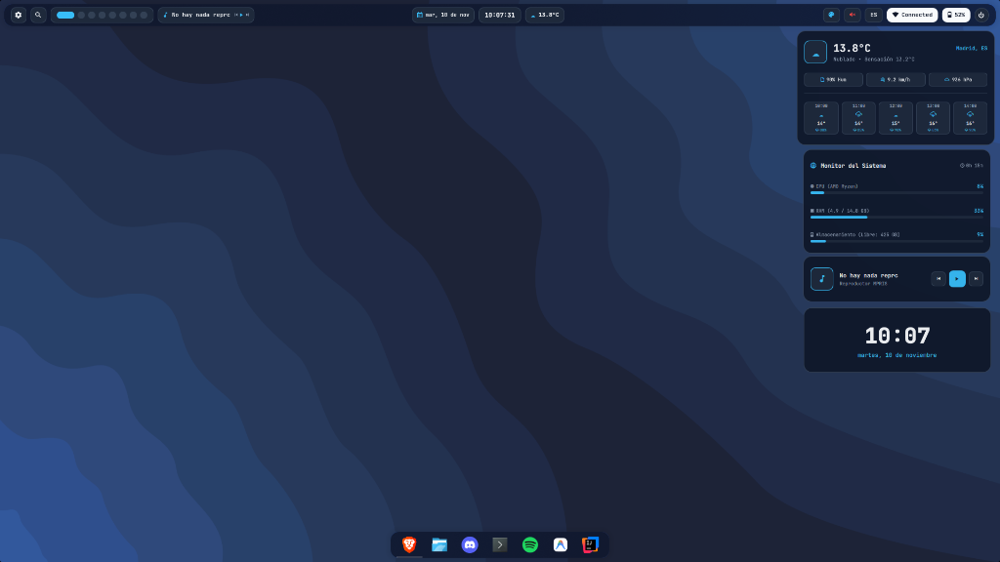

<div align="center">

# 🐍 Serpanplasma — Serpantinum for KDE Plasma 6

**The floating-window alternative and high-fidelity visual clone of *Serpantinum* engineered natively for KDE Plasma 6 (Wayland).**

[🇪🇸 Español](README.md) | [🇬🇧 English](README_EN.md)

[](https://github.com/ilyamiro/serpantinum)
[](https://kde.org/plasma-desktop/)
[](https://wayland.freedesktop.org/)
[](#-multi-distribution-installation)
[](#-key-features)
[](LICENSE)

<br/>



</div>

---

## 📖 Overview

**Serpanplasma** is a high-precision, faithful recreation of the clean minimalist aesthetic of **[Serpantinum](https://github.com/ilyamiro/serpantinum)** (ilyamiro's Quickshell desktop shell), engineered natively for **KDE Plasma 6 on Wayland**.

The project brings Serpantinum's modern visual language — translucent floating pill bars, rounded corners, and native real-time blur — into KDE Plasma. It removes the steep learning curve and friction of tiling window managers (such as Hyprland or Niri), preserving the familiarity, comfort, and productivity of standard floating window management.

---

## 🎯 Key Features

- ❌ **No Forced Tiling:** Enjoy complete workspace freedom with no automatic screen partitioning or dozens of complex keyboard shortcuts to memorize.
- 🪟 **True Floating Windows (Classic / Windows Style):**
  - Applications launch centered with comfortable default sizing.
  - Smooth dragging, resizing, and natural window overlapping.
  - Classic titlebar controls: Minimize (**_**), Maximize (**□**), and Close (**X**).
- ⌨️ **Standard Keyboard Shortcuts:**
  - `Alt + F4`: Close active window.
  - `Alt + Tab`: Switch between open applications.
  - `Win + Up Arrow`: Maximize active window.
  - `Win + Down Arrow`: Restore or minimize active window.
  - `Win + E`: Launch Dolphin file manager.
- 🛸 **Floating Top Bar with Native Pills (`org.serpanplasma.bar`):**
  - Translucent detached top panel with smooth rounded corners and KWin blur.
  - Discrete, standalone capsules matching Serpantinum's design language.
- ⚓ **Centered Floating Application Dock:**
  - Detached bottom dock with hover zoom effect and intelligent window dodging.
  - Subtle running task indicators and drag-and-drop pinning support.
- 🎛️ **Native Wayland Popup Dialogs:**
  - 󰖙 **Weather Card:** 4-day weather forecast with day switcher, feels-like temperature, relative humidity, and wind speed.
  - 󰃮 **Monthly Calendar:** Interactive monthly calendar view with smooth month navigation animations and live digital clock.
  - 󰁹 **Battery & Power Profiles:** Real-time charging state monitor and 1-click power profiles (`High Performance`, `Balanced`, `Power Saver`) with dynamic refresh rate and display brightness scaling on AC connect/disconnect.
  - 󰤨 **Network & Traffic:** Active interface details, Wi-Fi SSID, local IP, public IP, and real-time upload/download throughput monitors.
  - 󰕾 **Audio Controls:** Master volume slider, dynamic audio output device switcher (headphones, internal speakers, digital HDMI/DisplayPort), quick mute, and preset levels.
  - 󰌌 **Keyboard Layout Pill:** Clickable capsule to switch between keyboard layouts (e.g., `ES` and `US`) instantly.
  - ⏻ **Power Menu:** System dialog with direct actions for Shut Down, Reboot, Log Out, Lock Screen, and Suspend.
  - 󰏘 **Quick Theme Switcher:** Instant, live color switching between 8 curated dark and light themes.
- 🎨 **8 Curated Color Palettes (Dark & Light Modes):**
  - **Dark:** `Obsidian` (Serpantinum Official), `Catppuccin Mocha`, `Cyber Emerald`, `Deep Amethyst`, `Neon Ruby`.
  - **Light:** `Porcelain White`, `Catppuccin Latte`, `Nord Snow Polar`.
- 🖼️ **Comprehensive Wallpaper Management:**
  - Toggle automatic wallpaper rotation (slideshow).
  - Freeze the current wallpaper as static with a single click.
- 🧩 **Modular & Draggable Desktop Widgets:**
  - 4 independent floating cards: Hardware Monitor (CPU, RAM, Swap, Disk, and Thermal Sensors), Giant Digital Clock, Live Weather, and MPRIS Media Player.
  - Freely draggable across any part of your screen with individual toggle controls.
- ⚙️ **Integrated Settings & Guide Dashboard (`serpanplasma-settings`):**
  - Standalone Qt6/QML management dashboard featuring 9 specialized sections for real-time bar, dock, widget, and system customization.
- 🖥️ **Universal Hardware Compatibility:**
  - Fully adaptable to any screen resolution and native refresh rate (60Hz, 120Hz, 144Hz, 165Hz, 240Hz+).
  - Compatible with any GPU architecture (Intel/AMD integrated graphics, NVIDIA/AMD dedicated GPUs, or hybrid laptop setups with automatic RTD3 power-saving idle).

---

## 💎 Design Anatomy (1:1 Serpantinum Replica)

```
┌────────────────────────────────────────────────────────────────────────────────────────────────────────┐
│ [⚙] [ ━ ] ● ● ● ● ● ● ● [ ♫ Title ⏮ ▶ ⏭ ]   [15 Oct.] [ 17:32:27 ] [󰖙 22°C]   [󰏘] [󰕾] [EN] [󰤨 Net] [󰁹 100%] [⏻] │
└────────────────────────────────────────────────────────────────────────────────────────────────────────┘
```

### 1. Floating Top Bar
- **Left Zone:**
  - `[ ⚙ ]`: Quick launcher for the Serpanplasma Settings & Guide dashboard.
  - `[ ━ ] ● ● ● ● ● ● ●`: Interactive KWin 8-workspace switcher.
  - `[ ♫ Title - Artist ⏮ ▶ ⏭ ]`: Media capsule displaying MPRIS metadata with playback controls.
- **Center Zone (Mathematically Symmetrical Trio):**
  - `[ 15 Oct. ]`: Date pill opening the interactive monthly calendar.
  - `[ 17:32:27 ]`: **Mathematically centered digital clock** in JetBrains Mono Black.
  - `[ 󰖙 22.1°C ]`: Weather capsule opening the 4-day forecast dialog.
- **Right Zone:**
  - `[ 󰏘 ]`: Quick theme switcher dialog.
  - `[ 󰕾 ]`: Volume control pill with slider and output audio device selector.
  - `[ EN / ES ]`: Keyboard layout indicator and switcher.
  - `[ 󰤨 Net ]`: Network status pill with upload and download throughput.
  - `[ 󰁹 100% ]`: Battery capsule with power profile selector.
  - `[ ⏻ ]`: Power and session management dialog.

### 2. Centered Floating Application Dock
- Floating bottom bar detached from the lower screen edge.
- Preconfigured launchers for Terminal (`konsole`/`kitty`/`alacritty`), File Manager (`dolphin`), Web Browser, Discord, Spotify, and System Settings.
- Running application indicators and drag-and-drop pinning support.

---

## 📦 System Requirements

- **Desktop Environment:** **KDE Plasma 6.0 or higher** running under a **Wayland** session.
- **Audio Server:** PipeWire / WirePlumber or PulseAudio.
- **Required Core Utilities:** `git`, `python3`, `curl`, `jq`, `playerctl`, `brightnessctl`.

---

## 🚀 Multi-Distribution Installation

Before running the Serpanplasma setup script, install the required system packages using your distribution's package manager:

### 1. Arch Linux / CachyOS / EndeavourOS / Manjaro
```bash
sudo pacman -S --needed git python jq curl playerctl brightnessctl
```

### 2. Fedora / Nobara / RHEL
```bash
sudo dnf install git python3 jq curl playerctl brightnessctl
```

### 3. openSUSE Tumbleweed / Leap
```bash
sudo zypper install git python3 jq curl playerctl brightnessctl
```

### 4. Debian / Ubuntu / KDE neon / Kubuntu (with Plasma 6)
```bash
sudo apt update
sudo apt install git python3 jq curl playerctl brightnessctl
```

### 5. Other Distributions (Void, Alpine, Gentoo, etc.)
Install the equivalents of: `git`, `python3`, `jq`, `curl`, `playerctl`, and `brightnessctl` via your package manager.

---

### 📥 Clone and Install Serpanplasma

Once dependencies are installed, clone the repository and run the automated installer:

```bash
git clone https://github.com/jorjanion/Serpanplasma.git
cd Serpanplasma
chmod +x install.sh restore.sh
./install.sh
```

### What does the installer do automatically?
1. **Full Backup:** Backs up your existing KDE configuration files to `~/.config/serpanplasma-backup/`.
2. **Typography:** Installs and registers **JetBrains Mono Nerd Font** with fontconfig.
3. **Color Schemes:** Deploys all 8 palettes and applies the default **Obsidian** scheme.
4. **Native Plasmoid:** Installs `org.serpanplasma.bar` to your user plasmoids directory.
5. **Window Management:** Configures KWin for centered floating placement, background blur, and standard Windows shortcuts.
6. **Hardware Optimization:** Dynamically detects your display's native refresh rate and configures laptop power profiles and hybrid GPU idle management.
7. **Status Daemon:** Installs and enables the background microdaemon as a `systemd --user` service.
8. **Settings Dashboard:** Registers the `serpanplasma-settings` launcher and connects it to the top bar `[ ⚙ ]` button.

---

## 🛠️ Technical Architecture

Serpanplasma is cleanly structured into modular components:

```
Serpanplasma/
├── assets/                          # Graphic assets, screenshots, and launcher icons
├── configs/
│   ├── applications/                # Desktop entry for Serpanplasma Settings
│   ├── autostart/                   # Autostart entry for the status daemon
│   ├── bin/                         # CLI launcher (serpanplasma-settings)
│   ├── fastfetch/                   # Fastfetch system summary configuration
│   ├── guide/                       # Standalone Settings & Guide QML application
│   ├── kwin/                        # Floating window rules for KWin
│   ├── systemd/                     # Systemd user service for background daemon
│   ├── terminal/                    # Terminal profiles for Konsole, Kitty, and Alacritty
│   └── widgets/                     # Modular draggable desktop widgets
├── fonts/                           # JetBrains Mono Nerd Font typography
├── scripts/
│   ├── setup-panel.js               # Plasma scripting layout for bar and dock
│   ├── setup-wallpapers.js          # Wallpaper slideshow configuration script
│   └── status-daemon.py             # Ultra-lightweight local HTTP status daemon (<1ms)
├── themes/
│   ├── color-schemes/               # 8 color schemes for KDE Plasma
│   ├── plasma/
│   │   ├── desktoptheme/            # Serpanplasma desktop theme (Blur, SVGs)
│   │   └── plasmoids/
│   │       └── org.serpanplasma.bar # Native QML top bar plasmoid
│   └── window-decorations/          # Breeze configuration with rounded corners
├── install.sh                       # Automated installer script with backups
├── restore.sh                       # Restoration script to revert changes
├── README.md                        # Documentation in Spanish
└── README_EN.md                     # Documentation in English
```

### Background Status Microdaemon (`status-daemon.py`)
To ensure maximum UI smoothness and responsiveness without blocking PlasmaShell's main thread, a lightweight background microdaemon (written in pure Python with zero external pip dependencies) periodically collects system metrics:
- MPRIS media player monitoring via `playerctl`.
- Battery and AC power supply state via `/sys/class/power_supply`.
- Network interfaces and traffic throughput via `/proc/net/dev`.
- Volume levels and audio output sinks via PipeWire / WirePlumber (`wpctl` / `pactl`).
- Active virtual desktops queried over the KWin DBus bus (`qdbus6 org.kde.KWin`).
- Geolocated weather forecast fetched in the background via Open-Meteo.
- Local HTTP endpoint at `127.0.0.1:19842` queried instantly by the QML components.

---

## 🔄 Restoration / Uninstallation

To revert your desktop to its exact previous state prior to installing Serpanplasma:

```bash
cd Serpanplasma
./restore.sh
```

The restoration script:
1. Stops and disables the background daemon service (`serpanplasma-daemon.service`).
2. Removes the `org.serpanplasma.bar` plasmoid and user launchers.
3. Restores your exact previous KDE configuration files from the backup.
4. Restarts PlasmaShell to restore your original desktop session.

---

## 📄 License

This project is licensed under the **GNU General Public License v3.0 or later** ([GPL-3.0-or-later](LICENSE)).

Inspired by the visual design of **[Serpantinum](https://github.com/ilyamiro/serpantinum)** created by [ilyamiro](https://github.com/ilyamiro).
